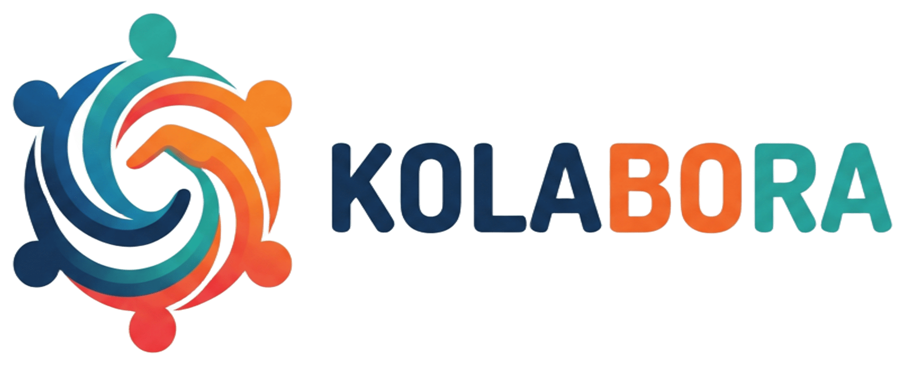

<div align="center">
  
</div>

# Kolabora

**Platform web untuk Kuliah Kerja Nyata (KKN):** instansi mempublikasikan masalah nyata di daerahnya, mahasiswa menelusuri dan mengerjakannya sebagai proyek, perusahaan menemukan talenta dari pengalaman lapangan, dan hasilnya tercatat sebagai portofolio yang bisa diverifikasi.

| | |
|---|---|
| Kompetisi | IT RUSH 2026, kategori Web Development |
| Subtema | Pendidikan, Tata Kelola, dan Teknologi Inklusif |
| Tim | Solo No Problem (individu) |
| Peserta | Kenzie Raffa Ardhana, Institut Teknologi Bandung |

## Daftar Isi

1. [Latar Belakang](#latar-belakang)
2. [Fitur](#fitur)
3. [Integrasi AI](#integrasi-ai)
4. [Arsitektur dan Tech Stack](#arsitektur-dan-tech-stack)
5. [Menjalankan Secara Lokal](#menjalankan-secara-lokal)
6. [Pengujian](#pengujian)
7. [Desain](#desain)
8. [Penggunaan AI Coding Assistant](#penggunaan-ai-coding-assistant)
9. [Deklarasi Pihak Ketiga](#deklarasi-pihak-ketiga)
10. [Akun Demo](#akun-demo)
11. [Referensi](#referensi)

## Latar Belakang

Setiap tahun ratusan ribu mahasiswa menjalani KKN, tetapi pengalamannya jarang diubah menjadi nilai yang diakui: masalah yang dikerjakan tidak selalu sesuai kebutuhan daerah, pengalaman lapangan sulit dibuktikan ke dunia kerja, dan laporan KKN tersimpan terpisah sehingga setiap angkatan mengulang dari nol. Pada saat yang sama, pengangguran sarjana masih tinggi dan perusahaan kesulitan menemukan talenta yang tepat (angka dan sumber: lihat [Referensi](#referensi)).

Kolabora menghubungkan tiga pihak dalam satu alur:

- **Instansi** menulis masalah yang perlu dikerjakan (lokasi, tujuan SDGs, kuota, tenggat).
- **Mahasiswa** memilih masalah yang sesuai, melamar, mengerjakannya, dan mendapat portofolio serta sertifikat digital.
- **Perusahaan** mencari talenta berdasarkan proyek yang benar-benar selesai.

## Fitur

**Halaman publik:** beranda dengan daftar masalah terbuka dan peta sebaran, tentang kami, kontak, profil publik instansi dan mahasiswa.

**Mahasiswa**
- Telusuri masalah (daftar, galeri, peta) dengan filter provinsi, tujuan SDGs, tingkat kesulitan, dan durasi.
- Kirim lamaran, pantau status (Menunggu, Ditinjau, Diterima, Ditolak, Dibatalkan), kelola proyek aktif.
- Repositori pengetahuan: laporan KKN yang dapat dicari dan ditanyakan ke asisten AI **Kora**.
- Jaringan teman, lowongan kerja dan perbandingannya, portofolio publik, profil yang bisa diunduh sebagai PDF.

**Instansi:** publikasi dan pengelolaan masalah, peninjauan lamaran, pemantauan proyek, ulasan mahasiswa, verifikasi dokumen institusi, penerbitan sertifikat digital.

**Perusahaan:** pencarian dan perbandingan talenta, lowongan, pengelolaan lamaran, talenta tersimpan, profil perusahaan.

**Admin:** peninjauan pendaftaran instansi (hasil verifikasi AI tetap dikonfirmasi manusia).

## Integrasi AI

AI dipakai sebagai fitur produk, bukan hiasan:

- **Kora (RAG):** asisten yang menjawab pertanyaan hanya dari dokumen di repositori pengetahuan dan menyertakan sumbernya. Dokumen dipecah dan di-*embed* dengan Cohere (`embed-multilingual-v3`), disimpan di PostgreSQL (Supabase `pgvector`), lalu konteks yang paling mirip dikirim ke model bahasa (Google Gemini, lewat satu klien `LlmClient`) dengan instruksi untuk tidak menjawab di luar dokumen. Bila kemiripan di bawah ambang, Kora menjawab bahwa informasi tidak tersedia.
- **Verifikasi dokumen instansi:** AI membantu memeriksa dokumen yang diunggah; keputusan akhir tetap oleh admin.
- **Saran proyek:** rekomendasi masalah yang sesuai dengan profil mahasiswa.

Implementasi ada di `app/Services/` (`ChatbotService`, `LlmClient`, `ClaudeAIService`, `CohereAIService`, `DocumentRetrieverService`, `PromptBuilderService`, `AIDocumentVerificationService`, `AIProjectSuggestionService`). Bila uraian di atas berbeda dengan kode, kode yang berlaku.

## Arsitektur dan Tech Stack

Monolit Laravel (tanpa overhead antarlayanan).

| Lapisan | Teknologi |
|---|---|
| Backend | Laravel 13, PHP 8.3, Laravel Sanctum |
| Tampilan | Blade, Tailwind CSS 4, Alpine.js, Vite |
| Database dan penyimpanan | PostgreSQL (Supabase), Supabase Storage |
| AI | Cohere (embedding), Google Gemini (jawaban; Anthropic Claude didukung sebagai cadangan lewat `AI_PROVIDER`) |
| Peta dan grafik | Leaflet + markercluster, Chart.js |
| Sertifikat dan PDF | GD (`CertificateService`), smalot/pdfparser untuk dokumen |

Peta kode: controller per peran di `app/Http/Controllers/{Student,Institution,Company,Admin}`, logika bisnis di `app/Services`, tampilan di `resources/views/<peran>`, aset desain di `resources/css/kolabora` dan `public/assets`.

## Menjalankan Secara Lokal

Prasyarat: PHP 8.3 (ekstensi `gd`, `pdo_pgsql`, `mbstring`, `intl`, `zip`), Composer, Node.js, dan proyek Supabase (PostgreSQL + Storage).

```bash
git clone <url-repositori>
cd kolabora

cp .env.example .env
# isi .env: koneksi database, kredensial Supabase Storage,
# COHERE_API_KEY, GEMINI_API_KEY

composer install
php artisan key:generate
php artisan migrate
npm install
npm run build

php artisan serve    # http://127.0.0.1:8000
```

Mode pengembangan (server, queue, log, dan Vite sekaligus): `composer dev`.

Produksi: set `APP_ENV=production` dan `APP_DEBUG=false`, jalankan `npm run build` di server (folder `public/build` tidak ikut repositori). Jangan memasukkan `.env` atau kunci API ke repositori.

## Pengujian

```bash
php artisan test
```

458 test memakai SQLite in-memory; semua permintaan HTTP keluar (Supabase, Cohere, Gemini, BPS) diblokir sehingga tidak butuh kunci atau jaringan.

## Desain

Antarmuka digerakkan token desain (satu sumber kebenaran) dengan bahasa visual yang diturunkan dari logo: teal sebagai warna utama, oranye sebagai aksen, navy untuk teks. Token ada di `resources/css/kolabora/tokens.css`, komponen `.kb-*` di `components.css`, dan gaya per halaman di berkas CSS bernama sesuai halamannya. Semua pasangan warna teks diuji kontrasnya (WCAG AA), dan audit aksesibilitas otomatis (axe-core) pada halaman kunci tanpa pelanggaran kontras.

## Penggunaan AI Coding Assistant

Asisten kode berbasis AI (**Claude Code**, Anthropic) digunakan selama pengembangan untuk: refaktor dan penyeragaman tampilan (sistem desain, palet, komponen), pembersihan kode dan penamaan, penulisan dan perbaikan test, serta penyusunan dokumentasi ini. Seluruh keluaran ditinjau dan diuji oleh pemilik repositori (`php artisan test`, `npm run build`, pemeriksaan visual) sebelum digabungkan.

AI sebagai **fitur produk** (Kora, verifikasi dokumen, saran proyek) dijelaskan di bagian [Integrasi AI](#integrasi-ai).

## Deklarasi Pihak Ketiga

| Komponen | Lisensi / ketentuan | Keterangan |
|---|---|---|
| Laravel, Sanctum, Tinker, smalot/pdfparser, flysystem-aws-s3-v3 | MIT / LGPL sesuai paket | lihat `composer.lock` |
| Tailwind CSS, Vite, Chart.js | MIT | lihat `package.json` |
| Alpine.js 3.13 | MIT | dimuat dari CDN jsDelivr |
| Leaflet 1.9, Leaflet.markercluster 1.5 | BSD-2 / MIT | dimuat dari CDN unpkg; ubin peta oleh OpenStreetMap contributors |
| Plus Jakarta Sans, Source Serif 4 | SIL OFL 1.1 | font lokal di `public/assets/fonts` |
| Poppins, Pinyon Script | SIL OFL 1.1 | hanya untuk sertifikat (`public/assets/certificate/fonts`) |
| Lucide | ISC | ikon, disajikan lokal (`public/assets/icons/ui`) |
| Foto Unsplash dan Pexels (60 foto) | Unsplash License / Pexels License | fotografer dan tautan sumber di `public/assets/photography/credits.json` |
| Foto dokumentasi kegiatan KKN | dokumentasi pemilik repositori | izin tampil dikonfirmasi pemilik |
| Logo Kolabora | karya tim | `public/assets/brand` |
| Template sertifikat | karya tim | `public/assets/certificate/template.png` |
| Cohere API, Google Gemini API (Anthropic API opsional), Supabase | layanan pihak ketiga, tunduk pada ketentuan masing-masing | membutuhkan kunci API sendiri |

## Akun Demo

Akun demo dibuat oleh seeder (`php artisan db:seed`; lihat `database/seeders`) dan kredensial untuk juri dicantumkan di dokumen proposal sesuai ketentuan kompetisi.

## Referensi

- Badan Pusat Statistik. (2025). *Keadaan Ketenagakerjaan Indonesia*, Februari dan Agustus 2025.
- Populix & KitaLulus. (2024). *Indonesia Talent & Recruitment Landscape 2024*.
- Hidajat, R. (2019). Evaluasi Program Kuliah Kerja Nyata di Indonesia. *Jurnal Pengabdian Masyarakat Indonesia*, 4(2), 101-112.
- Kementerian Desa, PDT. (2024). *Data Desa Digital Indonesia 2024*.
- NIST. (2023). *AI Risk Management Framework 1.0*.
- Lewis, P., dkk. (2020). Retrieval-Augmented Generation for Knowledge-Intensive NLP Tasks. *NeurIPS 33*.
- Undang-Undang Nomor 27 Tahun 2022 tentang Pelindungan Data Pribadi.
